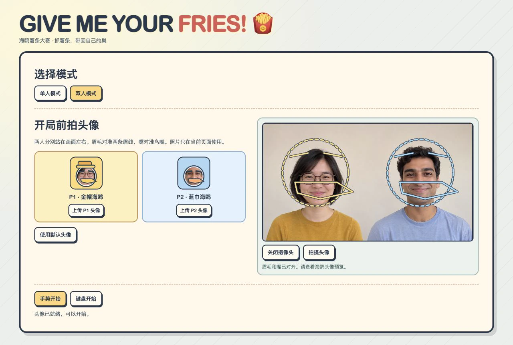
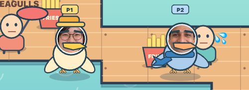

# GIVE ME YOUR FRIES! 🍟

[English](#english) · [简体中文](#简体中文) · [Big-screen development plan / 大屏开发计划](docs/full-body-big-screen-plan.md) · [Changelog / 更新日志](CHANGELOG.md)

## English

**A big-screen seagull game you play with your arms.** Stand in front of the camera, spread your arms like wings, and fly. The goal is to swoop down for fries, escape the visitor, and bring your haul back to the nest. The current focus is making that loop feel good for one player at exhibition distance.

### Try the repository baseline

The team's newer HTML prototype is awaiting upload. The links here are for the **existing repository baseline**, not that pending build. GitHub's file view does not run the game.

1. Download the repository and, from its root, run `python3 -m http.server 8000 --bind 127.0.0.1`.
2. Open the [arm-controlled flight demo](http://127.0.0.1:8000/demos/gull-flight/) in Chrome. Enable the camera, select the input, calibrate your stance, then start. The tracking models need internet on first load.
3. For a camera-free smoke test, open the [keyboard mode](http://127.0.0.1:8000/demos/gull-flight/?mode=keyboard). It helps check the game loop, not camera controls.

[Baseline source](demos/gull-flight/index.html) · [Development plan and acceptance checks](docs/full-body-big-screen-plan.md)

### Earlier prototypes

The [overhead full-body demo](demos/full-body/index.html), [archived flight iteration](demos/archive/gull-flight-before-runner-2026-11-19/index.html) and [Duo v2.4 hand-gesture game](GIVE_ME_YOUR_FRIES_DUO_GESTURE.html) are references, not the current development target. [Duo v2.4 instructions](#legacy-duo-v24-english) are kept below.

## 简体中文

**一款用手臂操控的大屏海鸥游戏。** 站在摄像头前，张开双臂像翅膀一样飞行，俯冲抢薯条、逃离游客，再把薯条带回巢穴。当前优先做好单人在展场距离下的完整体验。

团队已有新版 HTML 原型，尚待上传。以下入口用于试玩**仓库现有基线版**，不是待上传的新版本。GitHub 文件预览无法运行游戏。

1. 下载整个仓库，在根目录运行 `python3 -m http.server 8000 --bind 127.0.0.1`。
2. 用 Chrome 打开[手臂体感飞行](http://127.0.0.1:8000/demos/gull-flight/)，开启并选择摄像头，校准站位后开始。首次加载识别模型需要联网。
3. 没有摄像头时可使用[键盘模式](http://127.0.0.1:8000/demos/gull-flight/?mode=keyboard)检查玩法流程，但不能验证体感识别。

[大屏开发计划与验收](docs/full-body-big-screen-plan.md) · [早期俯视体感版](demos/full-body/index.html) · [旧版双人手势游戏](GIVE_ME_YOUR_FRIES_DUO_GESTURE.html)。旧版继续保留，不作为当前开发重点。

---

## Legacy Duo v2.4: English

Fly a seagull around the harbor, steal fries with its feet, and deliver them to your nest. Play a solo challenge or compete with a friend on the same map.

### 1. Download and open the game

Open the [game file](GIVE_ME_YOUR_FRIES_DUO_GESTURE.html) on GitHub, choose **Download raw file**, and open the downloaded HTML in Chrome. If Chrome blocks camera access for the local file, run `python3 -m http.server 8000` in the folder containing the HTML and open the game through [localhost](http://localhost:8000/GIVE_ME_YOUR_FRIES_DUO_GESTURE.html).

### 2. Choose a mode and set your avatar

- **Solo (单人模式)** gives you one gull and one nest. In webcam mode, use the entire camera frame.
- **Duo (双人模式)** gives each player a gull and a nest on the same map. Both players share one webcam. P1 wears a gold hat and starts on the left of the webcam preview. P2 wears a blue scarf and starts on the right. Both gulls can fly anywhere on the map.
- **Take a photo.** Click **开启摄像头** to turn on the camera. In Solo, use the center guide. In Duo, each player uses their own guide. Line up your eyebrows with the two brow lines and your mouth with the beak. Click **拍摄头像** to take the photo. Check the gull portrait on your player card as the game aligns the photo. Click again to retake it. You can also upload a photo or click **使用默认头像** to use the default avatars. Photos stay in the current page session.

*The game aligns the player’s eyebrows and mouth with the gull’s eyebrows and beak. These screenshots use generated demo portraits.*

### 3. Choose how to play

| Start option | What to do |
| --- | --- |
| **Camera gesture tutorial (摄像头手势教学)** | Allow camera access and wait for the hand-tracking model to load. The first load requires internet access. In Duo, each player holds one hand on their side of the preview. The outline over each hand shows which gull it controls. The tutorial waits for hand detection before proceeding. |
| **Keyboard tutorial (键盘教学)** | Select your avatars or the default portraits, then practice using the keyboard. |

The tutorial guides you through identifying your gull and nest, flying into your colored practice circle, collecting one fry, releasing to return home, and escaping a visitor warning circle. Each step checks the actual action. Duo waits for both players to finish. Completed exercises advance automatically, and the final three-second countdown starts round one.

The match timer stays paused during practice. The dodge exercise gives five seconds and repeats when needed. Practice scores reset when the match begins. Use **跳过练习，开始比赛** to begin immediately. If the camera or model cannot start, setup displays a message so you can retry or choose the keyboard tutorial.

If you are already playing with gestures and want to change controls, click **切换键盘** to switch to the keyboard.

### 4. Fly, grab fries, and return to your nest

| Action | Gesture | Keyboard |
| --- | --- | --- |
| Fly | Move your open hand. | Move with **WASD** for P1 or the **arrow keys** for P2. |
| Grab fries | Near a tray, pinch your thumb and index finger. | Near a tray, hold **F** for P1 or **K** for P2. |
| Return to the nest | With fries in your claws, open your hand while it is still in the frame. | With fries in your claws, release **F** or **K**. |

A gull can carry up to four fries. If your hand leaves the camera frame, the gull stays where it is until you bring your hand back. You can reposition trays on land with a mouse or touchscreen. A tray dropped into the water returns to its previous position. In Duo, diving into the other gull can knock fries out of its claws.

### 5. Escape the red circle and bank your score

The first fry alerts a nearby visitor. An exclamation mark appears above the visitor, and a red circle with a countdown marks the attack area. **Fly out before the countdown reaches zero.** The three rounds give you **1.65**, **1.50**, and **1.35 seconds** to escape.

A gull still inside the circle at zero is briefly stunned and drops every fry it is carrying. Once you reach your nest and deliver the fries, each one adds one point. Those points stay in your score if you are hit later.

### 6. Finish the match or play again

The three rounds last **65, 75, and 85 seconds**. When a round ends, the game shows the points earned in that round and the running total. Click **下一关** to start the next round. In Duo, the player with the higher total after all three rounds wins.

Click **再来一局** on the final screen to play again. During a match, **重新开局** restarts at round one and resets the score. **模式与头像** takes you back to setup.

## 旧版双人模式 v2.4：简体中文

**当前游戏版本 v2.4** · **更新时间 2026 年 11 月 19 日（UTC+8）**

控制海鸥飞过海港，用脚抓薯条，再带回自己的巢穴计分。可以一个人挑战，也可以和朋友在同一张地图上对战。

### 1. 下载并打开游戏

打开 GitHub 上的 [游戏文件](GIVE_ME_YOUR_FRIES_DUO_GESTURE.html)，点击 **Download raw file** 下载 HTML，再用 Chrome 打开。如果 Chrome 打开本地文件时无法使用摄像头，可以在 HTML 所在的文件夹运行 `python3 -m http.server 8000`，再通过 [localhost](http://localhost:8000/GIVE_ME_YOUR_FRIES_DUO_GESTURE.html) 打开游戏。

### 2. 选择模式并设置头像

- **单人模式**有一只海鸥和一个巢穴。用手势玩时，整幅摄像头画面都可以用来控制海鸥。
- **双人模式**有两只海鸥、两个巢穴。两人共用一个摄像头。P1 是金帽海鸥，从取景框左侧入镜，P2 是蓝巾海鸥，从右侧入镜。两只海鸥都可以飞遍同一张地图。
- **拍摄头像。** 点击**开启摄像头**。单人用中间的取景框，双人各用左右两侧的取景框。把眉毛对准两条眉线，嘴对准鸟嘴。点击**拍摄头像**后，游戏会尝试自动调整位置，玩家卡片会显示合成后的海鸥头像。再点一次可以重拍。也可以上传照片，或点击**使用默认头像**跳过拍照。照片只在当前页面使用。

*进入游戏后，照片里的眉毛和嘴会贴合海鸥的眉毛和鸟嘴。配图使用生成的演示头像。*

### 3. 选择手势或键盘

| 开始方式 | 怎么操作 |
| --- | --- |
| **摄像头手势教学** | 允许摄像头权限，等待手势模型加载。首次加载需要联网。双人各在取景框自己的半边伸出一只手，描线颜色对应各自的海鸥。教学先显示识别状态，识别到手后自动开始移动练习。 |
| **键盘教学** | 头像准备好后进入键盘练习。可以选择默认头像直接试玩。 |

教学依次带你认出海鸥和巢穴、飞入对应颜色的练习圈、抓一根薯条、松手回巢和飞出游客红圈。每一步按实际操作判断是否完成，双人等待两人都完成后自动继续，最后倒数 3 秒自动开始第一关。

练习期间暂停比赛计时，躲避练习提供 5 秒并允许重试。正式开局时练习分数归零。熟悉操作后可点**跳过练习，开始比赛**。摄像头或模型未能启动时，设置页会显示提示，可以重试或选择键盘教学。

手势游玩过程中，可以点击**切换键盘**改用键盘。

### 4. 飞行、抓薯条和回巢

| 动作 | 手势 | 键盘 |
| --- | --- | --- |
| 飞行 | 张开手掌并移动。 | P1 用 **WASD**，P2 用**方向键**。 |
| 抓薯条 | 飞到薯条盒附近，用拇指和食指捏合。 | 靠近薯条盒时，P1 按住 **F**，P2 按住 **K**。 |
| 回巢 | 抓到薯条后，手留在镜头内并松开手指。 | 抓到薯条后松开 **F** 或 **K**。 |

海鸥一次最多抓四根薯条。手离开镜头时，海鸥会停在原地，手重新入镜后可以继续飞行。薯条盒可以用鼠标或触屏在陆地上摆放，拖到海里会回到原位。双人模式下，俯冲撞到对手可以撞掉对方脚上的薯条。

### 5. 飞出红圈，把薯条带回巢穴

抓到第一根薯条时，附近游客头顶会亮起叹号，地图上出现红圈和倒计时。**倒计时归零前飞出红圈。** 三关依次有 **1.65 秒、1.50 秒和 1.35 秒**可以撤离。

归零时还在圈内的海鸥会被短暂击晕，脚上的薯条全部掉落。把薯条带回自己的巢穴后，每根计一分。已经入巢的分数会保留。

### 6. 结算、进入下一关和重玩

三关分别限时 **65、75、85 秒**。每关结束时，游戏会显示本关得分和累计分数。点击**下一关**继续。双人模式下，三关累计分数更高的一方获胜。

结算后可以点击**再来一局**。游戏过程中点击**重新开局**会回到第一关并重置分数，点击**模式与头像**可以回到开局设置。
